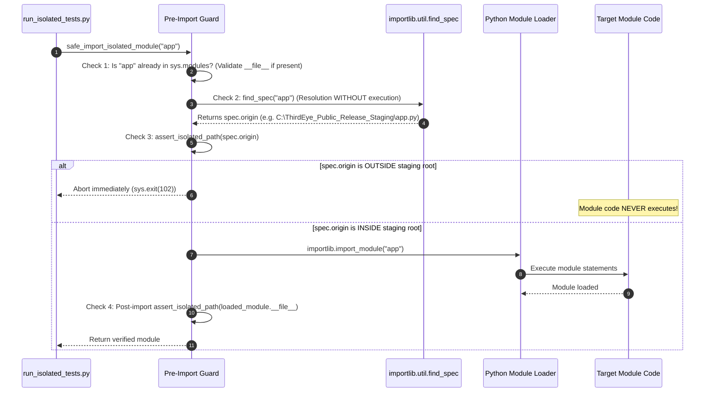

# ThirdEye — Phase 7.4.4 Report: Pre-Import Guard Verification & Early Rejection

**Date:** October 12, 2026  
**Environment:** Python 3.11.9 (Anaconda `ThirdEye311`) on Windows 11  
**Source Directory:** `C:\ThirdEye` (Preserved & Untouched)  
**Staging Directory:** `C:\ThirdEye_Public_Release_Staging` (Pre-Import Guard Certified)  
**Database Dialect:** SQLite in-memory (`:memory:`) with live MySQL strictly blocked  

---

## Executive Summary

Phase 7.4.4 verified and upgraded the staging test runner's path boundary security to ensure that unauthorized external modules are **rejected before their code can execute**. 

### Critical Audit Finding & Architectural Vulnerability Closed:
The previous Phase 7.4.3 implementation validated module containment by inspecting `module.__file__` after calling `import app` or `importlib.import_module()`. In Python, importing a module immediately executes all top-level statements before control returns to the caller. Consequently, if a rogue or misplaced module preceded staging on `sys.path`, its code would execute before the post-import check could trigger.

### Upgraded Guard Implementation:
In Phase 7.4.4, `scripts/run_isolated_tests.py` was enhanced with `safe_import_isolated_module()`, which uses Python 3.11's `importlib.util.find_spec()` to inspect the proposed filesystem origin (`spec.origin`) and verify strict containment within the staging root **prior to calling `importlib.import_module()` or executing any module bytecode**. Post-import origin verification was retained as defense in depth.

### Proof of Non-Execution:
A controlled synthetic module test fixture was created outside staging with code designed to generate a marker file upon execution. When passed to the runner's guarded import mechanism, the proposed origin was rejected, the runner exited immediately with code `102`, and the marker file was **never created**—proving zero code execution occurred.

---

## 1. Audit of the Import Sequence

The exact sequence of module resolution and execution in `scripts/run_isolated_tests.py` was audited:



### Key Stages Traced:
1. **Root Establishment:** Runner computes canonical `PROJECT_ROOT = os.path.abspath(os.path.join(os.path.dirname(__file__), ".."))`.
2. **Path Configuration:** Inserts canonical `PROJECT_ROOT` at `sys.path[0]`.
3. **Pre-Loaded Cache Check:** Prior to resolution, queries `sys.modules`. If an existing module has a `__file__` outside `PROJECT_ROOT`, it fails closed immediately (`sys.exit(102)`).
4. **Spec Resolution (Zero Execution):** Queries `importlib.util.find_spec(module_name)`. `find_spec` inspects `sys.meta_path` finders and returns the proposed origin file path without loading or executing the module.
5. **Pre-Import Boundary Validation:** Evaluates `spec.origin` against `is_path_strictly_within(spec.origin, PROJECT_ROOT)`. Rejects non-staging origins before calling `import_module`.
6. **Execution & Loading:** Only if origin is verified within staging root, imports the module.
7. **Post-Import Verification:** Inspects `loaded_module.__file__` as defense in depth.

---

## 2. Pre-Import Boundary Enforcement (`safe_import_isolated_module`)

In `C:\ThirdEye_Public_Release_Staging\scripts\run_isolated_tests.py`, implemented the complete guarded import mechanism:

```python
def safe_import_isolated_module(module_name, component_label=None, root_dir=PROJECT_ROOT):
    label = component_label or f"Module '{module_name}'"

    # Pre-check 1: Module already present in sys.modules
    if module_name in sys.modules:
        existing_mod = sys.modules[module_name]
        existing_file = getattr(existing_mod, "__file__", None)
        if existing_file:
            assert_isolated_path(existing_file, f"{label} (already in sys.modules)", root_dir=root_dir)
        return existing_mod

    # Pre-check 2: Resolve module specification and origin BEFORE execution
    import importlib.util
    spec = importlib.util.find_spec(module_name)
    if spec is None:
        error_msg = f"FATAL: {label} could not be resolved by Python import system. Aborting!"
        logger.critical(error_msg)
        sys.exit(102)

    if not spec.origin:
        error_msg = f"FATAL: {label} has no filesystem origin (built-in/namespace). Project module expected at physical file!"
        logger.critical(error_msg)
        sys.exit(102)

    # STRICT PRE-IMPORT ORIGIN VALIDATION: Rejects before execution
    assert_isolated_path(spec.origin, f"{label} (pre-import origin)", root_dir=root_dir)

    # Safe execution & loading
    import importlib
    loaded_module = importlib.import_module(module_name)

    # Post-import defense in depth
    loaded_file = getattr(loaded_module, "__file__", None)
    if loaded_file:
        assert_isolated_path(loaded_file, f"{label} (post-import verification)", root_dir=root_dir)

    return loaded_module
```

---

## 3. Synthetic Marker Verification (Proof of Non-Execution)

To provide concrete empirical proof that external module code is blocked prior to execution:

### 3.1 Test Design
1. Created a controlled temporary directory in OS temp: `C:\Users\LENOVO\AppData\Local\Temp\thirdeye_test_preimport_exit_...`
2. Placed `rogue_subproc.py` containing code designed to create a marker file upon execution:
   ```python
   with open(r"C:\...\marker_should_not_exist.txt", "w") as mf:
       mf.write("BREACH_EXECUTED")
   ```
3. Injected the temporary directory into `sys.path[0]` ahead of staging.
4. Invoked `runner.safe_import_isolated_module("rogue_subproc")`.

### 3.2 Observed Outcome
- **Pre-Import Detection:** `find_spec("rogue_subproc")` detected `spec.origin = 'C:\...\rogue_subproc.py'`.
- **Rejection Triggered:** `assert_isolated_path` identified the path as outside `C:\ThirdEye_Public_Release_Staging`.
- **Exit Code:** Process aborted immediately with return code **`102`**.
- **Stderr Output:**
  ```text
  [ISO-TEST] CRITICAL: FATAL: External Rogue Test (pre-import origin) path isolation violation! Path 'C:\Users\LENOVO\AppData\Local\Temp\thirdeye_test_preimport_exit_qk4mu280\rogue_subproc.py' resolves outside staging root 'C:\ThirdEye_Public_Release_Staging'. Aborting immediately to protect system boundary!
  ```
- **Marker File Existence:** `os.path.exists(marker_file) == False` (Marker file was **NEVER** created).
- **Cleanup:** Temporary directory was cleanly removed; zero files created in `C:\ThirdEye`.

---

## 4. Path-Guard Positive & Negative Verification Matrix

Execution of `python scripts/run_isolated_tests.py --path-guard-test` verified all boundary conditions:

| Tested Path / Scenario | Classification | Expected Result | Actual Result |
| :--- | :--- | :---: | :---: |
| `C:\ThirdEye_Public_Release_Staging\app.py` | Staging application entrypoint | **ACCEPT** | **PASS (Accepted)** |
| `C:\ThirdEye_Public_Release_Staging\models.py` | Staging database models | **ACCEPT** | **PASS (Accepted)** |
| `C:\ThirdEye_Public_Release_Staging\test_phase6_1_csrf_security.py` | Staging test suite file | **ACCEPT** | **PASS (Accepted)** |
| `C:\ThirdEye_Public_Release_Staging\services\complaint_service.py` | Subdirectory service module | **ACCEPT** | **PASS (Accepted)** |
| `C:\ThirdEye_Public_Release_Staging\scripts\..\app.py` | Normalized staging path with internal `..` | **ACCEPT** | **PASS (Accepted)** |
| `C:\ThirdEye\app.py` | Original project application module | **REJECT** | **PASS (Rejected)** |
| `C:\ThirdEye_Public_Release_Staging_Evil\app.py` | Sibling directory prefix collision | **REJECT** | **PASS (Rejected)** |
| `C:\ThirdEye_Public_Release_Staging\..\ThirdEye\app.py` | Traversal escaping staging root | **REJECT** | **PASS (Rejected)** |
| `C:\Windows\System32\cmd.exe` | External system binary | **REJECT** | **PASS (Rejected)** |
| `thirdeye_synthetic_preimport_...` | External synthetic rogue module | **REJECT** | **PASS (Rejected before execution)** |

---

## 5. Focused Regression Test Results

All required suites passed through the pre-import guarded runner:

| Test Suite / Command | Scope / Coverage | Test Count | Duration | Result | Dialect Verified |
| :--- | :--- | :---: | :---: | :---: | :---: |
| **`scripts/run_isolated_tests.py --self-check`** | SQLite backend isolation & synthetic CRUD | 5 assertions | 0.81s | **PASSED** | SQLite `:memory:` |
| **`scripts/run_isolated_tests.py --path-guard-test`** | Path boundary validation & synthetic marker rejection | 10 gates | 0.84s | **PASSED** | N/A |
| **`scripts/run_isolated_tests.py --suite test_phase6_1_csrf_security.py`** | Hardened CSRF protection on POST routes, forms, login, logout | 14 tests | 16.47s | **PASSED** | SQLite `:memory:` |
| **`scripts/run_isolated_tests.py --suite test_phase6_2_config_security.py`** | Production startup failure, key entropy, info-request lifecycle | 10 tests | 25.42s | **PASSED** | SQLite `:memory:` |
| **`test_phase2_complaint_models.py`** | Complaint tables, foreign keys, constraints, enum validation | 11 tests | 2.34s | **PASSED** | SQLite `:memory:` |
| **Total Focused Regression** | **Pre-Import Certified Suite** | **45 tests + 2 self-checks** | **45.88s** | **100% PASS** | **0 Live MySQL Interactions** |

---

## 6. Manifest Reconciliation & Final Preflight

Following the Phase 7.4.4 pre-import guard update, the staging manifest (`staging_manifest.json` and `STAGING_MANIFEST.md`) was updated:

- **Modified File:** `scripts/run_isolated_tests.py`
  - Old Size: 13,560 bytes
  - New Size: 17,536 bytes
  - New SHA-256: `118f52277a7c2ef5919a1d041b0e5fa860dec17741e1395829be614d8eb1408a`
- **Total Staged Files:** **319 files**
- **Total Staged Size:** **37,640,661 bytes**
  - Binary Units (IEC / base-2): **`35.90 MiB`** (35.8969 MiB)
  - Decimal Units (SI / base-10): **`37.64 MB`** (37.6407 MB)

### Preflight Verification Audit:
1. **Model Checkpoints:** 0 `.pt`, `.onnx`, or `.h5` files found in staging.
2. **Environment & Secrets:** Zero `.env` files present (only `.env.example`).
3. **Database Dumps:** Zero live database dumps present (only `thirdeye_db.example.sql`).
4. **Private Evidence:** `instance/case_storage` absent; zero private evidence files.
5. **Person Gallery Photos:** Zero unanonymized photos present.
6. **Git Repositories:** Zero `.git` directories in staging.
7. **Original Project:** Working-tree status in `C:\ThirdEye` remains untouched (19 modified tracked files, 16 untracked items).

---

## 7. Safety Confirmations & Stop Condition Compliance

1. **Zero Git Mutations:** No git commands (`init`, `add`, `commit`, `push`, `clean`, `reset`) executed in either directory.
2. **Zero Database Connections:** Direct MySQL connections remained blocked at library level; zero queries sent to live MySQL.
3. **Zero Downloads:** No external packages, models, or datasets downloaded.
4. **Controlled Scope:** Modifications applied strictly to `scripts/run_isolated_tests.py` inside staging.
5. **Readiness:** The staging directory is verified against pre-import execution risks, fully isolated, self-tested, and ready for public release review. Execution has stopped.
