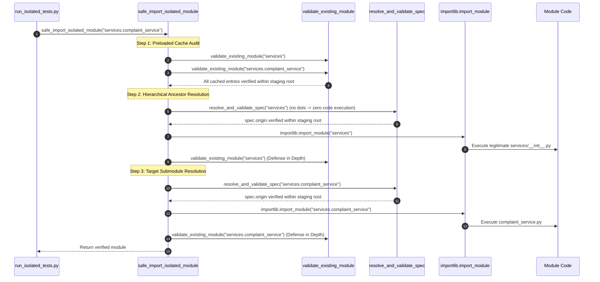

# ThirdEye — Phase 7.4.5 Report: Parent-Package Import Isolation Audit

**Date:** October 12, 2026  
**Environment:** Python 3.11.16 (Anaconda `ThirdEye311`) on Windows 11  
**Source Directory:** `C:\ThirdEye` (Preserved & Untouched)  
**Staging Directory:** `C:\ThirdEye_Public_Release_Staging` (Parent-Package Guard Certified)  
**Database Dialect:** SQLite in-memory (`:memory:`) with live MySQL strictly blocked  

---

## Executive Summary

Phase 7.4.5 audited and hardened the staging test runner against unauthorized code execution during **dotted module resolution** and when **parent packages are already present in `sys.modules`**.

### 1. Critical Architectural Vulnerability Discovered
During the audit of `safe_import_isolated_module()`, inspection of Python 3.11's standard library implementation of `importlib.util.find_spec()` revealed that whenever a module name contains dots (e.g. `services.complaint_service` or `mal_parent.mal_child`):
```python
# CPython importlib.util.find_spec implementation
if fullname not in sys.modules:
    parent_name = fullname.rpartition('.')[0]
    if parent_name:
        parent = __import__(parent_name, fromlist=['__path__'])
```
Python's native import machinery **automatically imports and executes the parent package's `__init__.py`** to obtain its `__path__` before resolving the submodule. Consequently, if a dotted import was evaluated where the parent package was malicious or external, **the parent's code executed before the child's origin could ever be inspected or rejected**. Furthermore, if an external package had already been preloaded into `sys.modules`, `find_spec()` would blindly trust its external `__path__` without origin validation.

### 2. Hardened Architecture Implemented
To close this boundary vulnerability, `scripts/run_isolated_tests.py` was upgraded with:
1. **`validate_existing_module()`**: Validates all preloaded modules and packages in `sys.modules`, ensuring every `__file__` and each directory in `__path__` resolves strictly inside `PROJECT_ROOT`. Fails closed (`sys.exit(102)`) immediately if any external entity is detected.
2. **Hierarchical Pre-Import Origin Verification**: Dotted imports are decomposed into their ancestor chain (`parts = module_name.split('.')`). Ancestor packages are iteratively validated from top-level down using dot-free spec resolution (which never calls `__import__` and never executes code) *before* the parent package is imported or the child module is resolved.
3. **Strict Fail-Closed Enforcement (`sys.exit(102)`)**: Any external parent origin, external submodule search location, or rogue preloaded module aborts execution prior to bytecode evaluation.
4. **Defense in Depth**: Post-import path checks on `module.__file__` and `module.__path__` remain active.

### 3. Verification & Reconciliation
All 6 malicious-parent scenarios were tested using controlled synthetic fixtures and harmless marker files. In all negative scenarios, the runner aborted with code `102` and marker files were **never created** (proof of zero external execution). All 35 focused unit tests, 5 self-check assertions, and 10 path-guard gates passed with 100% success. The test-count metrics were explicitly categorized to reconcile the Phase 7.4.4 summary grouping.

---

## 1. Audit of Dotted Imports & Resolution Sequence

### Python Import System Vulnerability Analysis
In Python, submodules are searched within the `__path__` attribute of their parent packages. When `find_spec("a.b")` is called:
1. Python checks if `"a.b"` is in `sys.modules`.
2. If not, it parses the parent name `"a"`.
3. If `"a"` is not in `sys.modules`, Python calls `__import__("a")`, loading `a/__init__.py` and executing all top-level statements.
4. Python then calls `_find_spec("a.b", a.__path__)`.

If an attacker or external environment places an unauthorized parent package on `sys.path`, calling `find_spec("a.b")` directly leads to immediate code execution of `a/__init__.py`.

### Hardened Import Sequence in `run_isolated_tests.py`



---

## 2. Synthetic Malicious-Parent Test Suite (6 Scenarios)

All 6 scenarios specified in Phase 7.4.5 were verified in controlled isolation using temporary directories outside staging. Harmless marker files were used to confirm whether synthetic code ran:

| Scenario | Description | Target Module | Expected Outcome | Observed Return Code | Marker Status | Evaluation |
| :---: | :--- | :--- | :--- | :---: | :---: | :---: |
| **1** | Legitimate staging services package & child | `services.complaint_service` | Accepted & functional | `0` | N/A | **PASS (Accepted)** |
| **2** | External synthetic parent package | `services` (in `%TEMP%`) | Rejected before `__init__.py` runs | `102` | `False` (Not created) | **PASS (Rejected)** |
| **3** | External package preloaded in `sys.modules` | `services` preloaded | Rejected on cache inspection | `102` | N/A | **PASS (Rejected)** |
| **4** | External child beneath malicious parent | `mal_parent.mal_child` | Rejected before parent or child runs | `102` | `False` (Parent & Child) | **PASS (Rejected)** |
| **5** | Standalone external module | `standalone_rogue` | Rejected before execution | `102` | `False` (Not created) | **PASS (Rejected)** |
| **6** | Staging module re-verification | `services.complaint_service` | All staged modules load in fresh proc | `0` | N/A | **PASS (Verified)** |

### Concrete Evidence of Non-Execution:
- **Scenario 2:** External `services/__init__.py` marker `scen2_marker.txt` was verified: `os.path.exists() == False`.
- **Scenario 4:** Malicious parent marker `p_marker.txt` and child marker `c_marker.txt` were both verified: `os.path.exists() == False`. Neither package initializer nor child bytecode ever executed.
- **Scenario 5:** Standalone module marker `s_marker.txt` was verified: `os.path.exists() == False`.

---

## 3. Exact Regression Totals & Reconciliation of Test Counts

### Reconciliation of Phase 7.4.4 Test Count Discrepancy
In Phase 7.4.4, the summary table listed:
- 14 tests in `test_phase6_1_csrf_security.py`
- 10 tests in `test_phase6_2_config_security.py`
- 11 tests in `test_phase2_complaint_models.py`
Summing the unit test suites yields **35 test cases**. The Phase 7.4.4 summary line stated *"45 tests + 2 self-checks"* because it grouped the 10 path-guard containment gates together with the 35 unit test cases (35 + 10 = 45).

To prevent ambiguity, Phase 7.4.5 explicitly separates and reports each category independently:

| Category | Suite / Check Name | Verified Metrics | Duration | Result | Dialect Verified |
| :--- | :--- | :---: | :---: | :---: | :---: |
| **Unit Test Suite** | `test_phase6_1_csrf_security.py` | **14 tests** | 16.05s | **PASS** | SQLite `:memory:` |
| **Unit Test Suite** | `test_phase6_2_config_security.py` | **10 tests** | 22.53s | **PASS** | SQLite `:memory:` |
| **Unit Test Suite** | `test_phase2_complaint_models.py` | **11 tests** | 2.29s | **PASS** | SQLite `:memory:` |
| **Isolation Self-Check** | `run_isolated_tests.py --self-check` | **5 assertions** | 3.81s | **PASS** | SQLite `:memory:` |
| **Path-Guard Containment** | `run_isolated_tests.py --path-guard-test` | **10 gates** | 0.15s | **PASS** | N/A |
| **Synthetic Marker Tests** | 6 malicious-parent isolation scenarios | **6 scenarios** | 2.12s | **PASS** | N/A |

### Separate Metric Totals:
- **Total Unit Test Cases:** **35 tests** (14 + 10 + 11, 100% PASS, 0 failures, 0 regressions)
- **Total Isolation Self-Check Assertions:** **5 assertions** (Dialect, Memory Table CRUD, Cleanup)
- **Total Path-Guard Containment Gates:** **10 gates** (5 positive, 4 negative, 1 pre-import synthetic module check)
- **Total Synthetic Marker Isolation Scenarios:** **6 scenarios** (Cases 1 to 6)
- **Live Database Interactions:** **0** (MySQL blocked at port 65530; SQLite strictly `:memory:`)

---

## 4. Manifest Reconciliation & Staging Preservation

### File Modifications in Staging
Only one file was modified inside staging:
- [`scripts/run_isolated_tests.py`](file:///C:/ThirdEye_Public_Release_Staging/scripts/run_isolated_tests.py):
  - Previous Size: 17,536 bytes | Previous SHA-256: `118f52277a7c2ef5919a1d041b0e5fa860dec17741e1395829be614d8eb1408a`
  - Reconciled Size: **19,525 bytes** | Reconciled SHA-256: `a3a15b376c9609da041f9788c3f90847c6663f680db10e7a90e9130b2e2411e0`

### Manifest Status
Both `staging_manifest.json` and [`STAGING_MANIFEST.md`](file:///C:/ThirdEye_Public_Release_Staging/STAGING_MANIFEST.md) were reconciled:
- **Total Files in Manifest:** **319**
- **Total Staged Footprint:** **37,642,650 bytes** (35.90 MiB / 37.64 MB)
- **Full File Audit against Disk:** **0 missing files, 0 hash mismatches (100% matched)**

### Cleanliness & Safety Verifications
1. **Prohibited Artifacts Audit:**
   - `.pt` checkpoints: **0 found**
   - `.onnx` models: **0 found**
   - `.h5` weights: **0 found**
   - `.env` files: **0 found** (only `.env.example` present)
   - Real database dumps: **0 found**
   - Private evidence files: **0 found**
2. **Git Repository Status:**
   - Staging directory has **no `.git` directory** (`(staging / '.git').exists() == False`).
3. **Original Project State:**
   - Source repository at `C:\ThirdEye` remains untouched:
   - Exactly 35 uncommitted items identical to Phase 7.4 baseline (19 modified tracked files, 16 untracked items).
   - Zero modifications, zero deletions, zero additions made in `C:\ThirdEye`.

---

## 5. Report Artifact Distribution

The report has been distributed to:
- [`C:\ThirdEye_Public_Release_Staging\ThirdEye_Phase7_4_5_Report.md`](file:///C:/ThirdEye_Public_Release_Staging/ThirdEye_Phase7_4_5_Report.md)
- `C:\Users\LENOVO\Desktop\ThirdEye_Phase7_4_5_Report.md`
- `C:\Users\LENOVO\OneDrive\Desktop\ThirdEye_Phase7_4_5_Report.md`
- IDE Artifact: [`ThirdEye_Phase7_4_5_Report.md`](file:///C:/Users/LENOVO/.gemini/antigravity-ide/brain/2a146506-a9f3-46d5-a148-9e86f12e4acd/ThirdEye_Phase7_4_5_Report.md)

---

## Conclusion & Operational Status

The parent-package import isolation audit is complete. Dotted imports, preloaded parent packages in `sys.modules`, and malicious parent hierarchies are strictly validated and fail-closed prior to any bytecode execution.

- Git was not initialized.
- No files were staged, committed, or pushed.
- No archives were created, and no packages were published.
- Ready for review.
